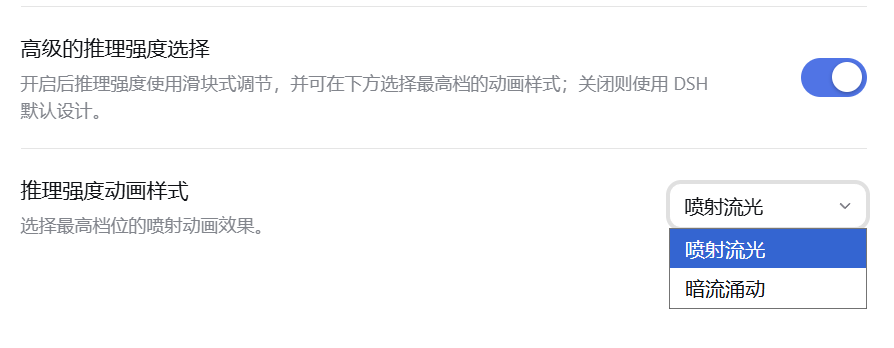
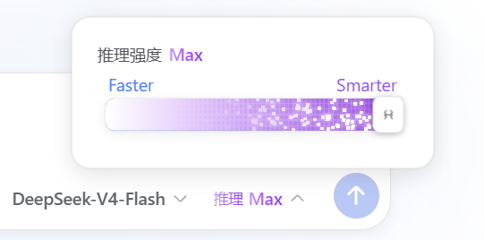
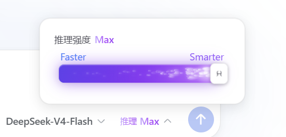

# @magiczerowxy/dsh-modef

把 DSH 输入框的模型选择器升级成「模型 + 推理强度」组合控件：模型仍是下拉菜单，推理强度改为 Claude 风格滑块，最高档可配四种动画特效。全部配置集中在 **设置 → 插件 → 插件配置** 的「高级推理等级滑块」卡片里。

A model picker + reasoning-effort slider for the DeepSeek Harness web UI. The model stays a dropdown; the effort control becomes a Claude-style slider with selectable max-tier animations.

## 版本与兼容 Compatibility

| 项 | 值 |
| --- | --- |
| 包版本 | `0.9.0` |
| DSH 运行时 | 0.1.7-rc.1 / 0.2.0-rc.1 / 0.2.0-rc.2 |
| 已实测 | 0.2.0-rc.2（桌面版） |
| Node | ≥ 20 |

**peer 范围就是开关。** DSH 0.2.0-rc.1 起，profile 在组合阶段会对每个 bundle 跑一次兼容性检查：`peerDependencies` 里所有 `@deepseek-ai/dsh*` 的范围都必须覆盖正在运行的 dsh 版本，**只要有一个不满足，整个 bundle 就被跳过 —— 而且界面上没有任何报错**（只有启动 stderr 里一行 `skipping profile bundle`）。

现象是：模型选择器变回官方样式，设置里也没有这张卡片。这不是「卡片挂了」，是这个条目根本没进组合树。用 0.2.0-rc.1 自带的 semver 实测可以看到 prerelease 的坑：

```
satisfies("0.2.0-rc.1", "^0.1.7-rc.1", {includePrerelease:true})   → false
satisfies("0.2.0-rc.1", "… || ^0.2.0-rc.1", {includePrerelease:true}) → true
```

带预发布段的版本，只有在范围里存在**同 `[major, minor, patch]` 且同样带预发布段的 comparator** 时才可能被接受 —— `includePrerelease` 也不解除这条限制。所以本包的 peer 范围里显式保留了运行时行；升级 DSH 后如果卡片消失，先查启动日志有没有 `skipping profile bundle`。

> 若你跑的是更靠前的预览版，可在插件管理器（或 `dsh plugin allow-version`）里为「精确的 包@版本 × dsh 版本」开豁免 —— 那是显式接受风险，peer 不匹配确实可能崩或丢数据。

## UI 效果

| 插件配置卡片 | 最高档特效（喷射流光） | 最高档特效（暗流涌动） |
| --- | --- | --- |
|  |  |  |

## 功能 Features

### 模型下拉菜单

- **两级结构，按名称汇集**：第一级按**模型名称**汇集，第二级选**提供商**。名称完全相同的模型合并成一行，**ID 相同与否不参与判断** —— 提供商 A 的 `deepseek-v4-pro` 与提供商 B 的 `deepseek-v4-pro-0813` 都叫 `DeepSeek-V4-Pro`，合并为一行；而只差大小写的 `Deepseek-v4-pro` 单独成行。判定就是原始 `name` 字符串的 `===`，不 trim、不做大小写折叠 —— **显示名就是身份**。
- **可切换为扁平列表**：设置里的「折叠模型供应商」开关（默认开启）控制两级行为。关闭后恢复按提供商分组的扁平列表：每个提供商一个分组标题、每个模型各占一行，没有 `>` 图标、没有侧边浮层。两种模式共用同一套行标记与同一个选择入口，所以配色、品牌图标、记忆功能表现一致。
- **默认值不写进设置文件**：开关默认开启，因此只有**关闭**会写入 `collapseProviders: false`；再打开则删除该键。从不碰这个开关的 profile 不会多出这个字段。
- **浮层不透明**：模型列表的背景用 `--dsw-alias-bg-layer-3`，两个主题下都是不透明色（`#fff` / `#353638`）。**不要**改用 `--dsw-specific-menu` —— 它在 0.1.7-rc.1 里被上游改成了带 alpha 的颜色（浅色 `#f8f9fa94`、深色 `#30313680`），用它会让列表变半透明。同一条不透明别名也是推理浮层 `color-mix()` 的底色：若底色自带 alpha，两个透明度会相乘，「62%」实际只剩 36%，毛玻璃开关就会反过来（拉满比关闭还透）。
- **列表能滚，但不画滚动条**：模型列表与第二级浮层共用一个滚动容器（`.dms-groups`，全插件唯一的滚动容器）。只保留上下滚动，右侧滑条不绘制：`overflow-y:auto` 原样保留，滚轮、触控板、触摸拖动、键盘、聚焦行的自动滚入都不受影响，消失的只是轨道与滑块。用的是伪元素的 `display:none`，不是容器的 `overflow:hidden`（后者会把滚动本身也干掉）。
- **长按拖动调整顺序**：在第一级列表里**长按一行 300ms**，该行悬浮成稍大的浮层并跟随指针；其余行自动流出空位；松手后平滑滑入落点，顺序持久化。作用范围仅第一级 —— 第二级是「某个名称下的提供商」，其顺序由记住的提供商决定；扁平模式也不支持（那是按提供商分组的结构，谈不上行的先后）。拖动中指针位移超过 **8px** 即视为滚动，取消长按，避免误触。拖到列表上下边缘 **30px** 内会自动滚动，速度随深入程度线性加快，上限 10px/帧。

### 品牌图标

每个模型行、以及输入框上的触发器，前面都有厂商品牌 SVG 标（共 27 个厂商，含 DeepSeek / 智谱 / Qwen / Kimi / Claude / Gemini / 百炼 / OpenRouter / Groq / StepFun 等）。品牌推导的层级固定为 **模型 ID → 显示名 → provider（其文本 → 其表）**：ID 最具体、provider 最不具体，所以**更具体的一方永远赢**（`claude-opus-4-6-thinking` 挂在 Gemini 代理路由上仍然是 Claude）。

- **代号 ID 的网关靠显示名认领品牌**：像 `dsh-provider-qoder` 这类多厂商网关，整条目录都用内部代号注册（`qmodel_38max` / `dmodel` / `gmodel` 等），ID 上推不出品牌。这类路由由**显示名**认领 —— 显示名本来就是第一级汇集的身份，对网关它是唯一还活着的身份信号。反过来，**provider 级条目绝不能压过显示名**：一个网关同时代理好几家的模型，把它的路由 id 映射成一个 logo 就等于给旗下每行都盖上那个 logo。
- **品牌未知时用兜底星标**，不留下空白槽。
- **未选中行的图标淡化到 0.6，选中行恢复 1.0**（0.15s 过渡）。淡化加在**槽位**而不是图标本身，因为列表里混着两类标记 —— `mono` 类用 `fill:currentColor` 绘制，品牌类自带硬编码填充色，而行文字色不随选中变化，两类都不会自己响应选中态。
- **Step 模型全系都有标**：匹配用段边界 `/stepfun|(^|[\/._-])step-/`，所以 `step-5-preview`、`step-2-16k`、`stepfun/step-3.5-flash` 都命中，而 `megastep-3`、`timestep-x9` 这种只是包含 `step-` 的别家模型不会被蹭上标。

### 可选提供商开关

**设置 → 模型** 页面底部有一个「可选提供商」面板，给每个提供商一个开关，控制它是否出现在本插件选择器里。

- **为什么在页面底部而不是每张卡片上**：「模型」页给每张提供商卡片留的扩展位是**键控** slot（`settings.models.provider-card`），一个 key 只允许一个条目，同优先级再注册会直接抛错；而本部署里那些最要紧的命名空间已被别的插件占住。所以开关落在 `settings.models.footer` —— 那是列表 slot，id 自取不冲突，同类插件也都在这里。
- **数据来自宿主目录**：列表取自 `remote.session.modelCatalog()`，**不是**选择器读的那个客户端目录 —— 后者正是这些开关要过滤的东西，用它建列表会让被关掉的提供商没地方再打开。
- **两个 DeepSeek 路由整行不出现**：`deepseek-official` 与 `deepseek-account` 在构建行列表时就被滤掉，是**缺席**而不是渲染一个禁用的开关。
- **关掉的是可见性，不是配置**：开关只维护一份被关掉的提供商路由 id 列表，**从不碰提供商自己的 profile**。端点、模型清单、凭据引用原样留着，打开开关立刻回来。
- **只影响本插件的选择器**：关掉一家后，官方选择器（本插件总开关关闭时用的那个）依旧会列出它的模型。本插件没有、也不打算有「让某个提供商彻底不可路由」的权限。

### 推理强度滑块

档位来自模型自己的 `reasoning` 配置（如 Off / High / Max），拖拽 / 点击 / 键盘均可调节，松手平滑吸附。

- **只使用模型真实声明的档位**：`reasoning.efforts` 为空或缺失时，档位列表为空，整个推理控件（头部档位文字、滑块、浮层）都不渲染 —— 与「模型完全没有 reasoning 配置」时的姿态一致。不会补一个选不中的合成 `Default` 档。
- **每个模型记住自己最后的档位**：把 DeepSeek V4.1 Flash 调到 Max，切到 GLM 5.3 调到 Low，再切回 Flash 仍是 **Max**，切回 GLM 仍是 **Low**。

  | 方面 | 做法 |
  | --- | --- |
  | 键 | `provider id + model id`（路由），**不是**模型名 |
  | 值 | 档位 ID（`low` / `high` / `max`），**不是**下标 |
  | 恢复前校验 | 记住的那一档必须仍在该模型的 `reasoning.efforts` 里，否则交还宿主的 `defaultEffort` |
  | 写入时机 | 用户按下档位的那一刻，不等宿主确认 |
  | 存储 | `localStorage` 的 `dsh-modef.effort-memory.v1`，上限 100 条，超出按最近最少使用淘汰 |

  键用**路由**而不用名称，是因为**档位只在某个具体模型的档位表里才有意义**，而两个提供商可以共用同一个显示名却给出不同的档位表。恢复的档位**跟着换模型的那一次 `select` 一起走**（`select(selection)` 本来就接受可选的 `reasoningEffort`），所以不会先闪一下模型默认档位再到记忆档位。
- **没有推理档位的模型，不显示推理控件**，与完全没配 `reasoning` 的模型一致。

### 最高档动画

四种样式，在设置卡片里选择：

- **喷射流光 (spray-flow)**：蓝紫渐变流光 + 火箭喷射粒子，粒子从喷口逐步点火喷出。
- **暗流涌动 (undertow)**：白→紫渐变点阵 + 亮点从右端喷射向左涌动、逐渐消散；进出最高档有对称的揭示/收起动画。
- **流体 (cosmos)**：浅色流体，近白浅蓝底上漂浮三层柔边墨团，边缘由 `filter:blur()` 化成云絮状，无闪点、无光斑、无条纹。**每次打开推理浮层随机重掷**：底色与每团墨的颜色、墨团数量/尺寸/位置、每层的游荡路径、时长、运动方向与初始相位全部随机。
- **晚霞 (sunset)**：配色采样自参考图的 median-cut 量化结果，11 个色值分四族（长春花蓝 / 紫罗兰 / 玫瑰褐 / 金橙）。天空是九段竖直渐变（配 `blur(4px)` 融掉色带），云雾是径向色块而非满高色带，光线会「呼吸」（关键帧同时动画 `transform` 与 `opacity`）。**每次打开浮层随机重掷**，三层各有不同的闭环游荡路径、时长、方向与相位，叠加永不重复。

两个随机样式都遵守 `prefers-reduced-motion`：每一轮发牌自带冻结条款，并排在该轮动画规则之后（同特异性下顺序在后者胜出）。静态样式表里的同构规则只是回退。

### 滑块栏形状

两种形状完全独立，各自的视觉互不影响，共用档位模型、渐变配色与全部动画。

- **圆角矩形**（默认）：圆角轨道 10px，白底圆角矩形手柄 9px 圆角带 ↕ 图标，顶部左对齐「推理强度 + 档位」文字，滑块两侧 Faster / Smarter 标签，浮层圆角 17px。
- **胶囊**：顶部居中一组「`Effort` 标签 + 档位小胶囊」（标签在上、胶囊在下），小胶囊为磨砂玻璃质感（20px 背景模糊、无镜面高光、柔和漫射边）；轨道与内条都变成长条胶囊，只有一层、不描边，仅靠四周均匀的柔和阴影体现轮廓。杆高 28px、手柄 20px、滑块行 36px、左右行程内缩 14px —— 这几个数字彼此绑定（半圆半径 = 杆高 / 2 = 14，所以 `fillCap` 与 `inset` 都必须是 14），在 CSS 与 JS 里各有一份，测试逐对互相校验。

胶囊形状下小胶囊还有两种动效：切到最高档时延迟 0.2s 斜向下扫过一道蓝紫渐变光（0.8s）；处于最高档期间保持放大 1.14 倍，切走时平滑缩回。扫光**只在浮层内把档位切到最高档**时播，单纯重开浮层不会播。

### 档位渐变文字

全档文字载体（小胶囊档位文字、圆角矩形头部档位文字、以及输入框上的「推理 + 档位」）按档位分两级着色：

- **最高档**：蓝 → 紫流动渐变，色标 `#3B82F6 → #6366F1 → #8B5CF6 → #A855F7`，3.5s 循环。
- **次高档**：淡蓝 → 蓝流动渐变，色标 `#7DD3FC → #38BDF8 → #2563EB`，4.5s 循环（周期刻意与最高档不同）。更低的档位保持纯色。

两级的取舍是**层级**：低档更淡、更偏青蓝，每一个色标都必须是「蓝 > 绿 > 红」，绝不能在中途转紫；最高档的色带红通道递增（蓝→紫的旅程）。色标全部落在饱和区间，整个动画周期内不会褪成白色。

### 浮层毛玻璃

可选的毛玻璃背景，配两个滑块：

| 设置 | 范围 | 默认 |
| --- | --- | --- |
| 毛玻璃透明度 | 20–90 % | 62 |
| 毛玻璃模糊半径 | 0–40 px | 16 |

透明度**上限是 90 而不是 100**：背景写作 `color-mix(in srgb, <不透明底色> P%, transparent)`，在 100% 时这个表达式等于底色本身 —— 与关闭毛玻璃画的是同一个颜色，而且背景不透明后 `backdrop-filter` 没有东西可模糊。滑块拉到顶部时「开关没反应」是正确观察；一个被保存下来的 100% 会跨会话地让这个功能自我失效，所以读取处会 clamp，存下的 100 会被自愈为 90。

> **毛玻璃下的「横向色带」**：有时会看到某一行像有一条淡淡底色，比面板其它位置更实。这不是那一行画了背景 —— 是**面板背后的内容**透过玻璃显出来的。有效杠杆是提高「毛玻璃透明度」（80% 以上基本压住）；提高模糊度基本无效（背景是大面积明暗差，不是一条边）。

### 实时 TPS

输入行「完全权限」右侧可显示实时 tok/s（默认关闭，开关在插件卡片上）。

- 生成中蓝点呼吸，结束后蓝点常驻、数字保留。
- 窗口内已无内容（思考停顿、工具间隙）时停采样并冻结当前数字，不闪没；下一个 chunk 到来时重新拉起采样。
- 用真实 `usage.outputTokens` 校准估算系数，本步落盘时给出真实平均速率。
- 这个开关走本机 `localStorage`，设置文档只作为跨 profile 备份的镜像 —— 文档写入失败只记日志，不会把卡片里其它字段的保存一起拖垮。

### 其他

- **模型名完整显示**：输入框里的选择器上限取自 DSH 自带的选择器 `min(360px, 45cqw)`，`45cqw` 相对输入框那一行（该行自己声明了 `container-type:inline-size`），所以上限随输入框宽度缩放。省略号保留作为最后兜底。
- **记住每个名称上次选的提供商**：用 `>` 选了某个提供商后，下次点这个名称的行会直接回到它，不再每次都从目录里第一个开始。记忆的键是第一级身份（模型名），值是该次选择的 `provider id + model id`，存在 `localStorage` 的 `dsh-modef.provider-memory.v1`，上限 100 条。记忆里的 provider + model 必须在当前目录里仍然存在才会被采用。
- **对勾是 SVG 描边**，不是 `✓` 字符：字形自带字体度量会让对勾列在不同机器上差一两像素，字体缺码位时还会渲染成方框。空状态由固定 14×14 盒子保证列宽不随选中变化。
- **每一行都有 `>`，包括只有一个提供商的名称**：行的形状不随提供商数量变化。`>` 的可见方框 18×18，外面套一圈不参与布局的 `::after` 隐形环，实际命中区 30×30。
- **WorkBuddy AI 的副行显示模型 ID**：这家把两个不同模型配了同一个显示名，于是必然会被汇集成一行，浮层里就会列出两条文字完全相同的行。ID 是唯一不同的文字，所以对这类厂商第二级副行显示 ID，并附上 credits 倍率。
- **键盘**：`↑` / `↓` 在第一级内移动；`→` 打开当前行的提供商浮层，`←` 收起；`Esc` 逐级退出 —— 先关浮层、菜单留在原地，再按一次才关菜单。
- **无缝接管**：开启后以低优先级（-100）遮蔽官方模型选择器，关闭即恢复官方设计。
- **拖动性能**：滑块几何一次性测量后缓存（拖动期间不再每事件/每帧读 DOM），指针移动按动画帧合并，避免每次读取都触发同步布局回流。

## 安装 Install

```bash
dsh plugin --profile <profile> add github:Magiczerowxy/dsh-modef
```

`<profile>` 换成你自己的 profile 名：DSH 桌面版默认用 `desktop`，Web 版用 `web`。不带 `--profile` 时操作默认 profile。命令会自动把包写入 profile 依赖，并因包声明了 `dsh.bundle` 自动加入 layer stack（`dsh.profile.bundles`）。

> npm 上的 `@magiczerowxy/dsh-modef` 仍是早期版本（`0.1.0`），**尚未包含当前版本**。请用上面的 GitHub 方式安装。

装好后需要**重启 DSH**：bundle 层是启动时组合的，刷新页面不够。

### 卸载

```bash
dsh plugin --profile <profile> remove @magiczerowxy/dsh-modef
```

## 使用 Usage

1. 打开 **设置 → 插件 → 插件配置**
2. 展开「**高级推理等级滑块**」卡片
3. 打开「高级的推理强度选择」，选择最高档动画样式，并按需开启毛玻璃、调节透明度与模糊度
4. 点「**保存**」提交（卡片标题会显示「未保存」直到提交；「放弃修改」丢弃草稿）
5. 输入框的模型下拉变为「模型 + 推理强度」组合控件，拖到最高档观看动画
6. 关闭总开关并保存即恢复 DSH 官方默认设计（配置保留）

可选提供商的开关在 **设置 → 模型** 页面底部。

## 结构 Structure

```
dsh-modef/
├── lib/
│   ├── index.js      # Host 半区：只导出 schemastery Config（设置项的可编辑 schema），由 loader 读取
│   └── client.js     # Client 半区：模型下拉 + 推理滑块 + 动画特效 + 插件配置卡片
├── test/smoke.cjs    # 无头冒烟测试（真实 client.js + React/Cordis 桩，65 项）
├── tests/            # 早期架构的回归文件，不参与当前测试门（见该目录 README）
├── screenshots/      # 界面截图
├── cordis.patch.yml  # bundle patch：insert dsh-modef entry
└── package.json      # dsh.bundle + dsh.client 声明
```

`client.js` 是**手写源码**，不是构建产物：没有打包配置、没有 `scripts`。直接编辑即可，改完存盘由 DSH 的 bundle 轮询自动热重载（Host 半区 `index.js` 除外，改它要重启）。

## 扩展点 Extension points

| Slot | 用途 |
| --- | --- |
| `plugins.item` | 卡片本体（list 槽）。用 `id: dsh-modef`、`order: 40` 与 `label`（跟随语言的 thunk）注册；插件页会以 `view: 'summary'` 与 `view: 'page'` 各渲染一次 |
| `conversation.input.model` | 组合控件，`priority: -100` 遮蔽官方选择器（仅总开关打开时占用） |
| `settings.models.footer` | 可选提供商开关面板（list 槽，`id: dsh-modef-providers`、`order: 30`） |
| `conversation.input.left` | 实时 TPS 指示器（list 槽，`id: dms-tps`） |

## 设置项 Settings keys

设置值存在**本插件在 profile 里的条目**中（条目 id 即 `dsh-modef`，由 `cordis.patch.yml` 声明）。文档按**条目**寻址，`configForms.get("dsh-modef")` 即该条目的表单。所有字段都必须声明为 `.volatile()` 才能被写入。

| 键 | 类型 | 默认 | 说明 |
| --- | --- | --- | --- |
| `advancedEffort` | boolean | `false` | 高级推理强度滑块总开关 |
| `effortStyle` | string | `spray-flow` | 最高档动画：`spray-flow` / `undertow` / `cosmos` / `sunset`。认不出的值自动回落到 `spray-flow` |
| `trackShape` | string | `rounded` | 滑块栏形状：`rounded` / `capsule` |
| `collapseProviders` | boolean | `true` | 模型列表按名称汇集（两级选择器） |
| `glassPanel` | boolean | `false` | 浮层毛玻璃 |
| `glassOpacity` | number | `62` | 毛玻璃透明度 20–90 (%) |
| `glassBlur` | number | `16` | 毛玻璃模糊半径 0–40 (px) |
| `tpsIndicator` | boolean | `false` | 实时 TPS 显示 |
| `disabledProviders` | string[] | *（无）* | 可选提供商面板里被关掉的提供商路由 id。它是本机列表的镜像（主拷贝在 `localStorage` 的 `dsh-modef.disabled-providers.v1`，因为开关必须立刻生效）：每次翻转先写本机、再镜像到这里（清空即 unset）。**从不改动任何提供商的 profile**。不显示在本卡片上 |
| `lastSeatError` | string | *（无）* | 仅供排查：最近一次组合控件崩溃的栈。不显示在卡片上 |
| `diag` | string[] | *（无）* | 保留声明只为兼容已存有该字段的 profile；当前版本没有写入者。不显示在卡片上 |

本机 UI 便利另有四个 `localStorage` 键，刻意不写进设置文档（每点一次就要写一次文件）：

| 键 | 内容 |
| --- | --- |
| `dsh-modef.provider-memory.v1` | 每个模型名上次选的提供商 |
| `dsh-modef.effort-memory.v1` | 每个路由（provider + model id）上次用的档位 |
| `dsh-modef.disabled-providers.v1` | 被关掉的提供商路由 id（主拷贝） |
| `dsh-modef.tps-indicator.v1` | TPS 显示开关的本机值（设置文档只作为备份镜像） |
| `dsh-modef.row-order.v1` | 第一级列表的行顺序（按名称） |

四个键共用同一套防御式访问：`localStorage` 在受限 / 隐私模式下可能**读取时就抛异常**，旧值也可能不是 JSON —— 一律「读不出来当没有、写不进去只损失持久化」，绝不会让选择器崩掉。

## License

MIT